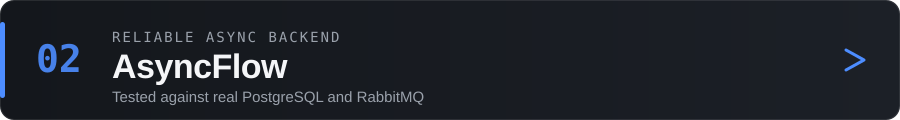

 

I'm a software engineer focused on backend, full-stack and AI systems. I build applications end to end (architecture, implementation, automated tests, deployment) and I spend my time on the parts that are easy to get wrong: **who is allowed to do what, what a customer is charged, what happens when a message is delivered twice, and what an AI agent may and may not do.**

My rule of thumb: critical rules belong in code, in the database and in tests, not in a prompt or in the UI. That shows up in my repositories as a deterministic policy engine in front of LLM tool calls, PostgreSQL Row Level Security, signature-verified payment webhooks, transactional outbox messaging, and retrieval that refuses to answer without evidence.

I use AI coding assistants as part of my daily workflow. Nothing they produce is accepted without review, and each project is verified with its own tests, linters and manual checks.

 

## Featured projects

Every project below is a public portfolio project. Each README states what is simulated or limited.

A demonstration of how to put a control plane around LLM agents. Agents only *propose* tool calls; a **tool gateway** is the single path to every tool and asks a deterministic **policy engine** (allow, require confirmation or deny) before anything runs. Sensitive actions suspend until a person approves exactly the action shown, and every step is written to a sanitised **audit trail**.

- Multi-agent flow orchestrated as a LangGraph state machine, with human-in-the-loop resume bound to the action's fingerprint
- Per-tool allow-lists plus an agent capability matrix, with adversarial security tests and a documented threat model
- CI with lint, strict mypy, offline and security suites, Redis/PostgreSQL integration tests and a container build
- Tools and data are simulated (a fictional retailer); the default AI is an offline stub, and Google Gemini is used when a key is provided

`Python` · `LangGraph` · `Google Gemini` · `MCP` · `Streamlit` · `PostgreSQL` · `Redis` · `Docker`

[Repository](https://github.com/eduardomartim/novamart-agente-platform)

 

A backend for running background tasks reliably. A task row and an outbox event are written in the **same database transaction**; a relay publishes to RabbitMQ afterwards, so nothing is published that wasn't committed and nothing committed goes unpublished.

- Idempotency keys, retries with exponential backoff (RabbitMQ message TTLs) and a dead-letter queue for permanent failures
- Outbox rows claimed with `FOR UPDATE SKIP LOCKED`; publisher confirms; graceful worker shutdown
- Delivery guarantees documented honestly: at-least-once, with duplicates made harmless
- 25 tests that run against real PostgreSQL and RabbitMQ containers

`Python` · `FastAPI` · `SQLAlchemy (async)` · `Alembic` · `PostgreSQL` · `RabbitMQ`

[Repository](https://github.com/eduardomartim/asyncflow)

 

A full-stack store (branded *Voltline*) built around the details that are easy to get wrong in e-commerce: prices always come from the database, an order counts as paid only when a **signature-verified Stripe webhook** says so (processed exactly once), and stock cannot be oversold.

- Server-side pricing and atomic stock reservation inside PostgreSQL functions; Row Level Security on every table
- Supabase Auth with email confirmation and recovery, customer order history and a protected admin area
- 82 Vitest unit/integration tests, 24 Playwright end-to-end tests (desktop and mobile) and pgTAP tests for database rules, as documented in the repository
- Payments run in Stripe **test mode**; no real products are sold

`Next.js` · `TypeScript` · `Supabase` · `PostgreSQL` · `Stripe` · `Tailwind CSS` · `Vitest` · `Playwright`

[Repository](https://github.com/eduardomartim/voltstore) · [Live demo](https://voltstore-beta.vercel.app)

 

A domain-specific assistant for GTA V Story Mode that answers from a curated knowledge base instead of guessing. It combines full-text search, pgvector similarity, structured SQL lookups and one-hop entity relationships, then shows sources with a `verified / curated / unverified` status.

- Evidence is checked **before** the model is called; with too little evidence the agent refuses without an LLM call, and invented citations are stripped
- Query planner answers data-style questions deterministically from SQL and graph queries
- Evaluation harness: 137-question regression suite, retrieval metrics report and an agent evaluation set
- Fan-made project; runs in a labelled demo mode when no LLM key is configured

`Next.js` · `TypeScript` · `PostgreSQL` · `pgvector` · `Zod`

[Repository](https://github.com/eduardomartim/gta-v-story-mode-ai) · [Live demo](https://gta-v-story-mode-ai.vercel.app)

 

A multi-tenant CRM for leads, activities and pipeline metrics. Tenant isolation is enforced by **PostgreSQL Row Level Security**, not by the UI, and the demo mode is read-only at the database level.

- Company provisioning through a Postgres trigger; privileged-field protection so users can't change their own role or tenant
- Dashboard KPIs computed from real lead and activity data
- The "AI" lead scoring is a **local rule-based heuristic**; no LLM or ML model is called

`React` · `Vite` · `Supabase` · `PostgreSQL` · `JavaScript`

[Repository](https://github.com/eduardomartim/leadflow-ai) · [Live demo](https://leadflow-ai-projeto.vercel.app/)

 

## Tech stack

Technologies that appear in the projects above.

<table>
  <tr>
    <td><b>Languages</b></td>
    <td>
      
    </td>
  </tr>
  <tr>
    <td><b>Backend</b></td>
    <td>
       
      SQLAlchemy · Alembic · Starlette · Stripe API
    </td>
  </tr>
  <tr>
    <td><b>Frontend</b></td>
    <td>
      
    </td>
  </tr>
  <tr>
    <td><b>Data &amp; auth</b></td>
    <td>
       
      Row Level Security · pgvector · SQLite FTS5
    </td>
  </tr>
  <tr>
    <td><b>AI &amp; agents</b></td>
    <td>
      LangGraph · Google Gemini · Model Context Protocol (MCP) · Retrieval-augmented generation · LLM provider adapters (Anthropic, OpenAI, Google)
    </td>
  </tr>
  <tr>
    <td><b>Quality &amp; delivery</b></td>
    <td>
       
      pytest · Playwright · pgTAP · Ruff · mypy · ESLint
    </td>
  </tr>
</table>

 

## Engineering focus

- **AI systems with guardrails:** policy-controlled tool execution, human approval, audit trails, grounded retrieval and evaluation harnesses.
- **Reliable backends:** transactional outbox, idempotency, retries with backoff, dead-letter queues and explicit delivery guarantees.
- **Security at the data layer:** Row Level Security, server-side pricing, signed webhooks and tests that try to break the rules.
- **Full-stack delivery:** typed interfaces, responsive UIs, CI pipelines and live deployments.

## How I build

1. **Define the invariants first.** What must never happen (an oversold item, a cross-tenant read, an unapproved write)?
2. **Put each rule where it can be enforced:** the database, a gateway or a policy engine, not only the interface.
3. **Build with AI assistants, then review everything.** I read, question and simplify generated code before it lands.
4. **Prove it.** Unit, integration, end-to-end and adversarial tests, run against real services where it matters.
5. **Document the limits.** Each README says what is simulated, untested or still open.

 

[**All repositories →**](https://github.com/eduardomartim?tab=repositories)

