 

I'm a software engineer focused on backend, full-stack and AI systems. I build applications end to end (architecture, implementation, automated tests and deployment), concentrating on the parts that are easy to get wrong: **who is allowed to do what, what a customer is charged, what happens when a message is delivered twice, and what an AI agent may and may not do.**

My rule of thumb is that critical rules belong in code, in the database and in tests, not in a prompt or in the UI. My portfolio projects reflect this: a deterministic policy engine in front of LLM tool calls, PostgreSQL Row Level Security, signature-verified payment webhooks, transactional outbox messaging and retrieval that declines to answer without evidence. They are portfolio projects, and each README states what is simulated or limited.

I use AI coding assistants as part of my workflow. I treat their output as a draft: it is reviewed before it is accepted, and each project is checked with its own tests, linters and manual verification.

 

 

 

 

## Engineering focus

- **AI systems with guardrails:** policy-controlled tool execution, human approval, audit trails, grounded retrieval and evaluation harnesses.
- **Reliable backends:** transactional outbox, idempotency, retries with backoff, dead-letter queues and explicit delivery guarantees.
- **Security at the data layer:** Row Level Security, server-side pricing, signed webhooks and tests that try to bypass these rules.
- **Full-stack delivery:** typed interfaces, responsive UIs, CI pipelines and public demo deployments.

## How I build

1. **Define the invariants first.** What must never happen (an oversold item, a cross-tenant read, an unapproved write)?
2. **Enforce each rule at the right layer:** the database, a gateway or a policy engine, not only the interface.
3. **Build with AI assistants, then review the result.** I read, question and simplify generated code before it is accepted.
4. **Prove it.** Unit, integration, end-to-end and adversarial tests, run against real services where it matters.
5. **Document the limits.** Each project README states what is simulated, untested or still open.

 

 

[**All repositories →**](https://github.com/eduardomartim?tab=repositories)

